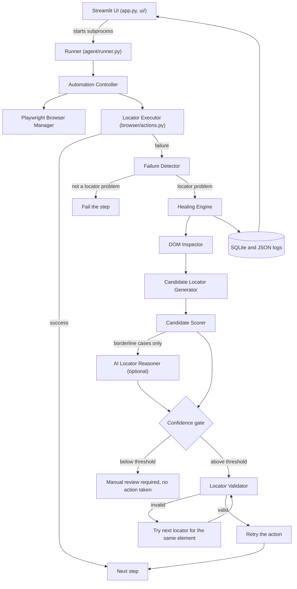

# Self-Healing Automation Agent

 

**A Playwright browser-automation agent that notices when a UI change breaks a locator, inspects the new page, picks the most likely replacement, proves it is the right element, and retries — or refuses and asks for review when it is not sure.**

| | |
|---|---|
| **What** | Self-healing browser automation |
| **Why** | UI changes break traditional test scripts |
| **How** | DOM inspection + candidate generation + scoring + optional AI reasoning + validation |
| **Result** | Broken locators are recovered automatically when confidence is high enough, and never guessed when it is not |

## Demo

<!-- Recording not added yet. After recording, replace this note with:    -->
> **A demo recording has not been added yet.** Run the app locally (below) and click **Run Demo**: a browser opens, a login test passes on UI v1, then the same old locators are run against changed UIs and healed live. The `docs/demo.gif` slot is reserved for a real recording; see [docs/demo-recording.md](docs/demo-recording.md) for how to make one.

## Problem

Test scripts find elements with locators such as `button#login`. When a developer renames an id, adds a `data-testid`, rewords a button, or changes CSS classes, the application still works but the script fails with a timeout. Teams then spend time re-pointing locators by hand, and many of those failures are not bugs at all.

## Solution

When a step fails, the agent treats it as a diagnosis problem instead of retrying blindly:

```text
button#login            -> FAIL  (locator_not_found)
inspect the live DOM    -> 10 elements, with attributes, labels, text, position
generate candidates     -> [data-testid="login-button"], role=button[name="Login"], ...
score and rank          -> 0.99 for the data-testid candidate
validate in the page    -> exactly 1 match, the intended element, visible, enabled
retry the action        -> SUCCESS   "Healed locator successfully."
```

If the evidence is weak the agent stops: **"Healing confidence too low — manual review required."** and does not perform the action.

## Features

- **Failure detection** that separates real locator problems (not found, ambiguous) from other failures (hidden element, invalid selector, browser crash), and only heals the former.
- **DOM inspector** that turns the live page into structured elements: id, test id, role, text, label, placeholder, classes, hierarchy path, visibility. Input values are never captured.
- **Candidate generation** with 11 strategies (test id, id, aria-label, role + name, name, label, placeholder, text, href, classes, DOM path), de-duplicated, with generated-looking ids and CSS classes discounted.
- **Transparent scoring** from text match, attribute similarity, synonym-aware semantic similarity, element type, accessibility, uniqueness, visibility and DOM proximity. Every factor is stored and shown.
- **Optional LLM reasoning** (Ollama or Google Gemini). It only sees the top candidates, must choose from them, and cannot override the safety rules. The app works fully without it.
- **Validation before action:** the proposed locator must resolve, match exactly one element, be the intended element, and be visible and enabled when the action needs it.
- **Safety limits:** confidence threshold, bounded validation attempts, bounded retries, timeouts, browser-crash restart, JSON-parsing fallbacks, invalid-locator handling.
- **Learns from passing runs:** while a locator still works, the agent remembers what element it points at, which improves later healing.
- **Streamlit dashboard** with a one-click demo, live step log, healing explanations, DOM inspector, history, reports and settings.
- **Persistent history** in SQLite plus structured JSON Lines and readable logs, with CSV/JSON/Markdown downloads. Metrics are computed only from stored runs.
- **Demo website** with four UI versions that break locators in different ways.

## Architecture



More detail and design decisions: [docs/architecture.md](docs/architecture.md).

## Tech stack

| Area | Choice |
|---|---|
| Language | Python 3.11+ |
| Browser automation | Playwright (Firefox) |
| UI | Streamlit |
| Storage | SQLite (standard library) plus JSON Lines logs |
| AI (optional) | Ollama local models or Google Gemini through a small provider abstraction |
| HTTP, config | `requests`, `python-dotenv` |
| Testing | pytest, pytest-cov |

No agent framework is used: the pipeline is plain Python so every decision is inspectable.

## How it works

1. **Detect.** A step fails. The detector asks the page what happened: 0 matches (not found), more than one (ambiguous), found but hidden or disabled, malformed locator, or a closed browser. Only the first two are healable.
2. **Inspect.** The current DOM is parsed into elements with attributes, accessible names, labels, nearby text, hierarchy and visibility.
3. **Generate.** Each element yields several candidate locators, de-duplicated, with a uniqueness count.
4. **Score.** `score = 0.65 × evidence + 0.35 × quality`.
   *Evidence* is how well the element matches the intent of the broken locator (text, attributes, synonyms such as login ≈ sign in, optional baseline fingerprint). *Quality* is how good the locator is (unique, stable strategy, right element type, accessible, visible, enabled).
   Confidence then drops if a close rival element exists, and is capped when the locator is ambiguous or there is no evidence.
5. **Ask the LLM, only when borderline.** If confidence is under the threshold but there is some evidence, the top candidates are sent to the model. It must pick from the list; invented locators are rejected. An agreeing model adds at most +0.15; a disagreeing one is capped below the default threshold. Timeouts, an unreachable server, or bad JSON fall back to the deterministic result.
6. **Gate.** Below `CONFIDENCE_THRESHOLD` (default 0.75) nothing is done.
7. **Validate.** In the live page: resolves, exactly one match, intended element, visible/enabled as needed. If it fails, other locators for the same element are tried (up to `MAX_HEALING_ATTEMPTS`).
8. **Retry** the failed action with the new locator (up to `ACTION_RETRIES`), then record everything.

A failing step first waits for `ACTION_TIMEOUT_MS` before healing starts, so that wait, not the healing itself, dominates the time to recover. Lower it for faster feedback on pages that load quickly.

Example healing record (abridged output of the test suite's browser-free page, so timings are omitted):

```json
{
  "test_name": "login flow @v2",
  "original_locator": "button#login",
  "failure_type": "locator_not_found",
  "selected_locator": "[data-testid=\"login-button\"]",
  "strategy": "test_id",
  "confidence": 0.9886,
  "source": "deterministic",
  "status": "healed",
  "message": "Healed locator successfully.",
  "validation_result": { "valid": true, "count": 1 },
  "retry_result": { "success": true, "attempts": 1 }
}
```

## Installation

Requirements: Windows 10/11 (other systems work with the equivalent commands), Python 3.11+, Git.

```powershell
git clone https://github.com/<your-username>/self-healing-automation-agent.git
cd self-healing-automation-agent
python -m venv .venv
.venv\Scripts\activate
pip install -r requirements.txt
playwright install firefox
copy .env.example .env
```

If PowerShell blocks activation: `Set-ExecutionPolicy -Scope CurrentUser RemoteSigned`, then reopen the terminal.

## Run

```powershell
streamlit run app.py
```

Open http://localhost:8501 and click **Run Demo** (about 30-60 seconds). You can also run the same scenario without the UI:

```powershell
python -m agent.runner --versions v2,v3
```

## Run tests

```powershell
pytest                                   # everything (browser tests skip if Firefox is missing)
pytest -m "not browser"                  # fast, no Firefox needed
pytest --cov --cov-report=term-missing   # measure coverage on your machine
```

Coverage is not quoted here because a number is only worth publishing after you have measured it. See [docs/testing.md](docs/testing.md) for what is tested where and for a script that injects deliberate bugs to check that the tests notice.

## Configuration

Copy `.env.example` to `.env`. Everything has a default; the app works with no LLM and no API key.

| Variable | Default | Meaning |
|---|---|---|
| `LLM_PROVIDER` | `none` | `none` (deterministic only), `ollama`, or `gemini` |
| `OLLAMA_URL` | `http://localhost:11434` | Ollama server |
| `OLLAMA_MODEL` | `llama3.2` | Model to use (`ollama pull llama3.2`) |
| `GEMINI_API_KEY` | empty | Google Gemini API key. Keep it in `.env`, which is git-ignored |
| `GEMINI_MODEL` | `gemini-3.8-flash` | Gemini model name |
| `CONFIDENCE_THRESHOLD` | `0.75` | Below this, healing is refused |
| `MAX_HEALING_ATTEMPTS` | `2` | Locators validated per failure |
| `ACTION_TIMEOUT_MS` | `3000` | How long an action waits before failing |
| `ACTION_RETRIES` | `2` | Retries of the healed action |
| `LLM_TIMEOUT_S` | `30` | Time allowed for the model to answer |
| `DB_PATH` | `data/healing.db` | SQLite database |
| `LOG_DIR` | `data/logs` | Log files |
| `SCREENSHOT_DIR` | `screenshots` | Failure screenshots |
| `LOG_LEVEL` | `INFO` | Log verbosity |
| `REUSE_HEALED_LOCATORS` | `false` | Reuse repairs from earlier runs instead of healing again |
| `SHOWCASE_MODE` | `false` | Read-only hosted copy that shows a recorded run instead of launching browsers ([docs/deployment.md](docs/deployment.md)) |
| `SHOWCASE_FILE` | `showcase/showcase_run.json` | The exported run that showcase mode displays |
| `HEADLESS` | `false` | Hide the browser window |

To use a free local model: install [Ollama](https://ollama.com/download), run `ollama pull llama3.2`, and set `LLM_PROVIDER=ollama`. The Settings tab can test the connection. Model quality varies; small models sometimes return invalid JSON, in which case the agent retries once and then falls back to the deterministic result.

To use Gemini, set `LLM_PROVIDER=gemini` and `GEMINI_API_KEY` in `.env`. `GEMINI_MODEL` defaults to `gemini-3.8-flash`.

## Project structure

```text
self-healing-automation-agent/
├── app.py                  Streamlit entry point
├── agent/
│   ├── controller.py       runs tests, applies healing, restarts after crashes
│   ├── healing_engine.py   detect -> inspect -> score -> LLM -> validate -> retry
│   ├── failure_detector.py classifies why an action failed
│   ├── dom_inspector.py    live page -> structured elements
│   ├── locator_generator.py candidate locators
│   ├── candidate_scorer.py scoring, confidence, safety caps
│   ├── llm_reasoner.py     optional LLM second opinion, strict JSON, fallbacks
│   ├── locator_validator.py proves a locator hits the intended element
│   ├── runner.py           CLI used by the UI; emits JSON events
│   ├── scenarios.py        demo scenarios
│   ├── logging_setup.py    structured and readable logs
│   └── config.py           settings from .env
├── browser/                Playwright manager and action executor
├── demo_site/              local demo website with UI versions v1-v4
├── storage/database.py     SQLite storage
├── ui/                     Streamlit pages and the logic behind them
├── tests/                  pytest suite (browser-free fakes + real-browser tests)
├── scripts/                phase demos and the mutation check
├── docs/                   architecture.md, testing.md
├── RUN_GUIDE.md            step-by-step run and troubleshooting guide
└── LICENSE
```

## Benchmarks

`python -m scripts.benchmark` measures the agent on the demo site against hand-written ground truth: correct heals, wrong heals, refusals, must-refuse cases, healing time, recovery time and overhead, with and without a learned baseline. `python -m scripts.resume_bullets` turns a result into resume bullets using only the measured numbers. No results are published in this repository yet; run it yourself and quote the counts together with the scope. Details and definitions: [docs/benchmarks.md](docs/benchmarks.md).

## Deployment

The app is meant to run locally, where you can watch the browser. Hosted platforms generally cannot show a browser window and have small resource limits, so the plan is: a recorded demo in the README, a read-only **showcase mode** that displays a real exported run, GitHub Actions running the full suite on every push, and a headless Docker image for self-hosting. See [docs/deployment.md](docs/deployment.md) and [docs/github-setup.md](docs/github-setup.md).

## Limitations

- **Tested on a small demo site.** The bundled demo has four UI versions of one login page. Behaviour on real-world applications has not been benchmarked, and no accuracy or success-rate figure is claimed.
- **Thresholds and weights are heuristics**, tuned by hand on those demo pages. Expect to tune `CONFIDENCE_THRESHOLD` for other sites.
- **Self-healing can hide real defects.** A renamed button might be an intended change or a regression. Review the healing history; do not treat "healed" as "correct".
- **Synonym matching is a small English word list** (login/sign in, username/email, ...). Other languages and domain vocabulary need extending.
- **Not inspected:** iframes, shadow DOM, canvas content, and elements created after the snapshot.
- **Actions supported:** click, fill, get text, assert visible. No hover, drag, file upload, or multi-tab flows yet.
- **Dynamic text is avoided by heuristic.** Locators are not built from text that contains values the test typed, numbers, emails or prices, but this rule can miss other kinds of changing text.
- **Repairs are recorded, not written back.** Healed locators are stored and can be reused at run time, but your test source files are not edited automatically.
- **Firefox only**, run locally. Hosted Streamlit environments generally cannot launch browsers; see Deployment above for showcase mode, CI and Docker.
- **Local SQLite, no authentication.** Intended for a single user on one machine.
- **Optional LLM quality depends on the model.** The deterministic path is the reference behaviour; the LLM can lift borderline cases but cannot override the safety rules.

## Future improvements

- Benchmark on a larger set of real pages and report measured healing success, recovery and overhead.
- Write healed locators back to test source as a reviewable patch.
- Visual signals (screenshots, element position) as extra evidence.
- iframe and shadow-DOM support, more action types, Firefox and WebKit.
- Pluggable synonym and domain dictionaries.
- Optional embeddings for semantic similarity.
- Verify the Docker image and a hosted showcase deployment (both are provided but untested by the author).

## License

MIT. See [LICENSE](LICENSE). Ayyappan M
