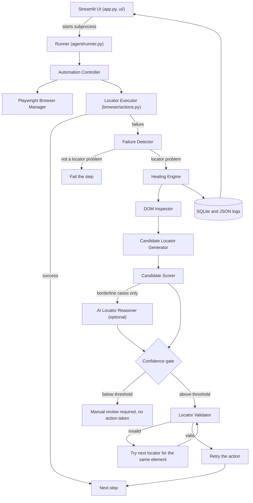
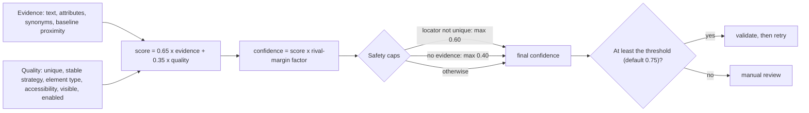

# Architecture

## Components

| Module | Responsibility |
|---|---|
| `browser/manager.py` | Starts and stops Chromium, restarts it after a crash and returns to the last page |
| `browser/actions.py` | Runs one action (click, fill, get text, assert visible); a broken locator returns a failed result instead of raising |
| `agent/failure_detector.py` | Decides why an action failed and whether it is healable; captures URL, title, screenshot, timestamp |
| `agent/dom_inspector.py` | Parses the live page into structured elements (attributes, labels, nearby text, hierarchy, visibility) |
| `agent/locator_generator.py` | Turns elements into Playwright locator strings, de-duplicated, with uniqueness counts |
| `agent/candidate_scorer.py` | Scores candidates, computes confidence, applies caps for ambiguity and missing evidence |
| `agent/llm_reasoner.py` | Optional second opinion from an LLM; strict JSON, candidates only, timeouts, retries, fallbacks |
| `agent/locator_validator.py` | Proves a locator matches exactly one element, the intended one, in the right state |
| `agent/healing_engine.py` | Orchestrates the pipeline and produces one structured `HealingRecord` per attempt |
| `agent/controller.py` | Runs a test's steps, reuses repairs, learns baselines, restarts after crashes, emits progress events |
| `agent/runner.py` | Command-line entry point; prints one JSON event per line; persists to storage |
| `storage/database.py`, `agent/logging_setup.py` | SQLite tables and JSON Lines / readable logs |
| `ui/` | Streamlit pages; business logic (metrics, explanations, exports, live log) lives in plain modules that are unit-tested |

## Scoring and confidence

## Design decisions

- **Deterministic first, LLM second.** The scorer always runs and is the reference behaviour. The LLM is consulted only for borderline cases, sees only the top candidates, must choose from them, and can add at most 0.15 when it agrees. Disagreement is capped below the default threshold. The app is fully functional with no LLM.
- **Never act on low confidence.** Below the threshold the action is not performed, which prevents a wrong guess from clicking the wrong control.
- **Validate before trusting.** Both deterministic and LLM proposals must pass the same live-page checks.
- **Evidence and quality are separate.** A well-formed locator on the wrong element must not score highly; the evidence score is what ties an element to the original intent.
- **Baselines only help.** A fingerprint learned from a passing run can raise evidence but never lower it, because the old attributes may be exactly what changed.
- **Browser runs in a subprocess.** The Streamlit UI launches `agent.runner`, which streams JSON events. This keeps Playwright out of Streamlit's event loop, isolates browser crashes, and lets the same run work from the command line.
- **Plain modules behind thin pages.** Metrics, explanations, exports and the live log are ordinary functions that are unit-tested without Streamlit or a browser.
- **No invented numbers.** Dashboard metrics come only from stored runs and show a dash when there is no data.
